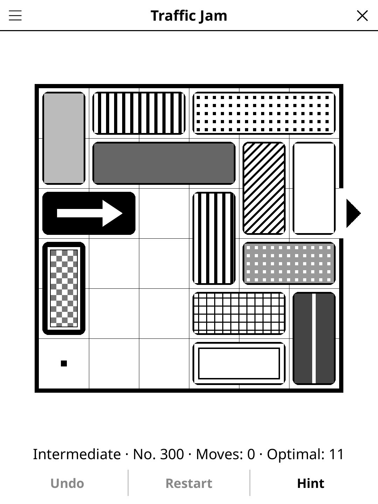

# trafficjam.koplugin

**Traffic Jam** (FR « Embouteillage ») — a sliding-block car puzzle for
[KOReader](https://github.com/koreader/koreader), in the style of the
classic: get the black car out of a jammed car park.

## Screenshot

## Rules

1. The car park is a 6×6 grid with one exit, in the right-hand wall of the
   third row. Get the black car with the white arrow out through it.
2. Cars take two squares, trucks three. A vehicle only slides along its
   length — never sideways, never through another vehicle.
3. Sliding one vehicle any distance counts as one move. Each level shows its
   optimal number of moves; matching it is a perfect score.

## Features

- **2400 original levels**, 600 per difficulty, graded by optimal moves:
  *Beginner* 3–8, *Intermediate* 9–17, *Advanced* 18–29, *Expert* 30–50.
  Each band is ordered from its easiest level to its hardest.
- **Progress** — "New game" opens the next level you haven't solved; the
  *Level* menu lists every level of the difficulty (✓ on solved ones, ★ on
  those solved in the optimal number of moves without a hint) and the
  *Difficulty* menu shows how many you've solved, and how many in the
  minimum.
- **Daily Challenge** — the same level for everyone today.
- **Hint** — two taps: the first marks the vehicle to move and outlines its
  destination, the second plays it. Hints always follow an optimal solution
  from where you are, so each one brings the exit one move closer.
- **Show solution** — gives up the level and steps through an optimal
  solution, forwards and back.
- **Undo**, **Restart**, moves counter, timer and auto-save.

## Controls

| Action | How |
|--------|-----|
| Select a vehicle | Tap it (dots mark where it can go) |
| Slide it | Tap a dotted square, or swipe the vehicle to send it all the way |
| Undo / Restart / Hint | Buttons under the board |
| New game, Daily Challenge, difficulty, level, solution, rules | Title-bar menu |

## Why e-ink friendly?

Black, white and a few flat greys; each vehicle has its own fill pattern
(stripes, dots, hatching, checks…) and a gap around it, so neighbours stay
apart without colour. No animation: a move repaints the screen once.

## Levels

The levels are not taken from any published card set. They are generated
offline by `tools/` (not shipped): random layouts are explored state by
state, a breadth-first search from every solved position gives each position
its exact optimal move count, and a hill-climbing search looks for layouts
with longer solutions. The game ships the result as `levels_data.lua`, one line
per level (36-character board + optimal moves). Rebuild with
`tools/build_levels.sh`.

## License

GPL-3.0
